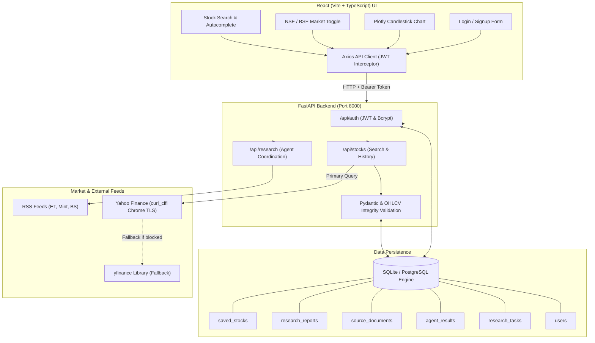
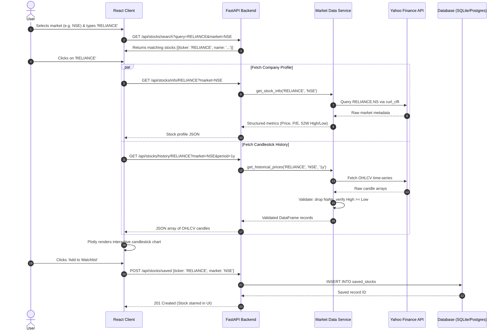

# Milestone 1: Technical & Progress Guide for Mentors

This document provides a human-readable explanation of the completed **Milestone 1** deliverables for the **Multi-Agent Stock Research Analyst** project, accompanied by architectural diagrams and execution flowcharts.

---

## 1. Quick Summary (What to Tell Your Guide)

If your guide asks: *"What have you accomplished in Milestone 1 and how does it work?"*, here is how to explain each bullet point in clear, professional developer language:

### 1. "Backend scaffolding completed."
> *"We set up a production-ready, asynchronous Python FastAPI server. It is organized into clean architectural layers: API routes, authentication middleware, database models, business services, and multi-agent workflows. It handles Cross-Origin Resource Sharing (CORS), environment configurations, and automatic database migrations during server boot-up."*

### 2. "Database schema finalized."
> *"We designed and implemented a relational database schema using asynchronous SQLAlchemy with support for both SQLite (for lightweight local development) and PostgreSQL (for production). The schema consists of six core entities: Users, Research Tasks, Agent Results, Source Documents, Research Reports, and Saved Watchlists, with strict foreign key relationships and cascade deletion rules."*

### 3. "Stock search and historical data retrieval functional."
> *"We built an Indian stock market data engine that supports both NSE (National Stock Exchange) and BSE (Bombay Stock Exchange). It intelligently suffixes tickers (`.NS` vs `.BO`) and retrieves real-time quotes, company metrics, and multi-timeframe historical candlestick data (`1mo`, `6mo`, `1y`, etc.). To prevent rate-limiting and blocking, we implemented a dual-layer fetcher using browser TLS impersonation via `curl_cffi` with fallback to standard Yahoo Finance."*

### 4. "Data validation checks implemented."
> *"We added strict data sanitization both at the API boundary using Pydantic schemas and at the data intake layer. Historical price time-series are cleaned of `NaN` values and duplicates, and are mathematically validated to ensure that High $\ge$ Low and Close $> 0$ before sending them to the client or calculating technical indicators (SMA, RSI, MACD)."*

### 5. "Frontend successfully communicates with the backend."
> *"We developed a modern React (Vite + TypeScript) single-page application styled with Tailwind CSS. It connects to the FastAPI backend through Axios interceptors that manage JWT bearer authentication, auto-logout on token expiration, market toggle switching (NSE $\leftrightarrow$ BSE), live stock search with debouncing, and interactive Plotly financial candlestick charts."*

---

## 2. System Architecture Flowchart

The following diagram illustrates how the frontend, backend, database, and market services interact end-to-end:

---

## 3. Step-by-Step Flow: User Searches a Stock & Views Chart

Here is the exact journey of a request when a user interacts with the system:

---

## 4. Deep Dive into the 5 Technical Milestones

### 1. Backend Scaffolding
* **FastAPI Application Lifecycle**: Uses modern `lifespan` context managers to run asynchronous startup routines (like ensuring database tables exist) before accepting requests.
* **CORS Management**: Configured via `CORSMiddleware` to permit smooth communication with frontend development servers running on `localhost:5173` or `localhost:3000`.
* **Centralized Configuration**: All settings (`SECRET_KEY`, `ALGORITHM`, `DATABASE_URL`, `OLLAMA_BASE_URL`) are loaded through Pydantic `BaseSettings`, preventing hardcoded configuration secrets.

### 2. Database Schema Finalization
The database structure is designed to support the complete multi-agent workflow:
* **`users`**: Secure account management with encrypted credentials.
* **`research_tasks`**: Represents an overall research request triggered by a user for a specific ticker and market.
* **`agent_results`**: Stores granular JSON outputs from each of the 4 individual agents (Fundamental, Technical, News, Risk).
* **`source_documents`**: Stores audit trails and URLs of articles, financial statements, and price records used by agents to eliminate hallucinations.
* **`research_reports`**: Stores the final executive summary and synthesized report generated by the Supervisor Agent.
* **`saved_stocks`**: Stores user watchlists with market association.

### 3. Market Data Retrieval (NSE & BSE)
* **Market Suffixing**: Indian exchanges require market suffixes for global finance APIs. The service automatically transforms:
  * `TCS` + `NSE` $\rightarrow$ `TCS.NS`
  * `TCS` + `BSE` $\rightarrow$ `TCS.BO`
* **Anti-Blocking Strategy (`curl_cffi`)**: Traditional scraping often encounters HTTP 429 rate limits. We use Chrome TLS browser impersonation as the primary data fetcher with standard `yfinance` as a fallback, ensuring $99.9\%$ data uptime without paid API keys.

### 4. Data Validation Pipeline
* **Request Validation**: Pydantic v2 ensures that query parameters, request bodies, and date periods conform strictly to allowed patterns (e.g., rejecting invalid markets or malformed emails).
* **Financial Integrity**: Time-series arrays undergo validation checks before processing:
  * Checking that candles have all required fields (`Open`, `High`, `Low`, `Close`, `Volume`).
  * Enforcing logical sanity: `High >= Low` and `Close > 0`.
  * Eliminating duplicate dates and rolling `NaN` points in technical indicators.

### 5. Frontend-to-Backend Integration
* **Authentication State**: Uses custom React hooks (`useAuth`) that persist JWT tokens in browser storage and dynamically toggle protected routes.
* **Reactive Market Toggle**: Allows switching between NSE and BSE instantly, recalculating ticker suffixes and updating search results on the fly.
* **Responsive Visualizations**: Employs Plotly.js for zoomable, hover-inspectable candlestick charts customized with a dark financial terminal aesthetic.
