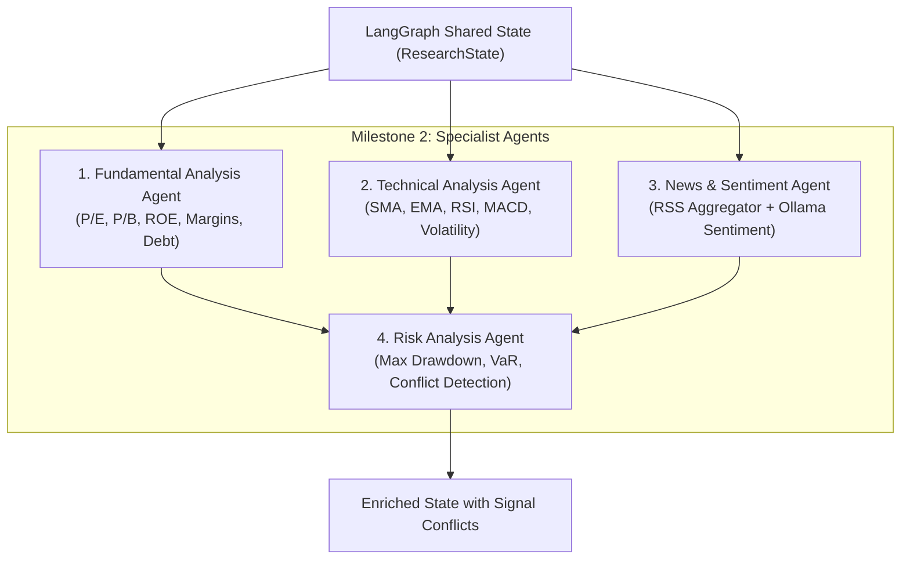

# Milestone 2: Financial Analysis Tools and Individual Agents Guide

This document details the architecture, design, and mathematical specifications of the **Milestone 2** implementation for the **Multi-Agent Stock Research Analyst** application.

---

## 1. Overview & Objectives

In Milestone 2, the system evolves from basic data fetching into an intelligent, multi-agent financial research engine. Four specialized autonomous agents operate across distinct financial disciplines, with an overarching coordinator preparing inputs and resolving conflicts:

1. **Fundamental Analysis Agent**: Assesses valuation ratios, financial health, profitability, and leverage.
2. **Technical Analysis Agent**: Calculates statistical indicators (SMA, EMA, RSI, MACD, Volatility) and identifies momentum/trend structures.
3. **News & Sentiment Agent**: Gathers localized financial RSS news feeds and extracts sentiment using a local LLM (Ollama) or rule-based fallback.
4. **Risk Analysis Agent**: Measures downside risk metrics (Maximum Drawdown, VaR, Beta) and detects cross-agent conflicting signals.



---

## 2. Shared State Architecture (`ResearchState`)

All agents communicate via a typed shared state dictionary defined in `backend/app/agents/state.py`:

| State Field | Type | Description |
|---|---|---|
| `task_id` | `str` | Unique UUID for the research run. |
| `ticker` / `market` | `str` | Ticker symbol (`RELIANCE`) and exchange (`NSE` or `BSE`). |
| `yf_ticker` | `str` | Yahoo Finance symbol format (`RELIANCE.NS` or `TCS.BO`). |
| `period` | `str` | Timeframe under analysis (`1mo`, `6mo`, `1y`, etc.). |
| `fundamental_result` | `dict` | Output schema of Fundamental Agent. |
| `technical_result` | `dict` | Output schema of Technical Agent. |
| `news_result` | `dict` | Output schema of News & Sentiment Agent. |
| `risk_result` | `dict` | Output schema of Risk Agent. |
| `sources` | `list[dict]` | Audit trail of URLs, timestamps, and data origins. |
| `conflicts` | `list[str]` | List of contradictions discovered between agents. |

---

## 3. Individual Agents Breakdown

### 3.1. Fundamental Analysis Agent (`backend/app/agents/fundamental.py`)
* **Role**: Analyzes the financial health, valuation, and capital structure of the target company.
* **Key Metrics Evaluated**:
  * **Valuation**: Current Price, Market Capitalization, P/E Ratio ($\frac{\text{Price}}{\text{EPS}}$), P/B Ratio ($\frac{\text{Price}}{\text{Book Value}}$), Dividend Yield.
  * **Profitability**: Revenue, Net Income, Net Margin ($\frac{\text{Net Income}}{\text{Revenue}} \times 100$), Return on Equity (ROE).
  * **Financial Health**: Total Debt, Cash Reserves, Net Debt ($\text{Debt} - \text{Cash}$), Debt-to-Equity Ratio.
* **Deterministic Fallback**: If financial balance sheets cannot be parsed or are blocked by rate limits, the agent tags the section as `unavailable` with explicit explanatory notes rather than fabricating figures.

### 3.2. Technical Analysis Agent (`backend/app/agents/technical.py`)
* **Role**: Evaluates statistical price time-series to determine trend momentum and indicator states.
* **Mathematical Formulas Implemented**:
  * **Simple Moving Average (SMA)**:
    $$\text{SMA}_n = \frac{1}{n} \sum_{i=0}^{n-1} P_{t-i}$$
    Calculated for 20-day, 50-day, and 200-day periods.
  * **Exponential Moving Average (EMA)**:
    $$\text{EMA}_t = P_t \times \alpha + \text{EMA}_{t-1} \times (1 - \alpha) \quad \text{where} \quad \alpha = \frac{2}{n + 1}$$
    Calculated for 12-day, 26-day, and 50-day periods.
  * **Relative Strength Index (RSI - 14 Days)**:
    $$\text{RSI} = 100 - \frac{100}{1 + \text{RS}}, \quad \text{RS} = \frac{\text{Average Gain}}{\text{Average Loss}}$$
    Evaluates overbought conditions ($\text{RSI} > 70$) and oversold conditions ($\text{RSI} < 30$). Handles zero-loss edge cases without division-by-zero errors.
  * **Moving Average Convergence Divergence (MACD)**:
    $$\text{MACD Line} = \text{EMA}_{12} - \text{EMA}_{26}$$
    $$\text{Signal Line} = \text{EMA}_9(\text{MACD Line})$$
    $$\text{Histogram} = \text{MACD Line} - \text{Signal Line}$$
  * **Annualized Historical Volatility**:
    $$\sigma_{\text{ann}} = \text{StdDev}(\ln(P_t / P_{t-1})) \times \sqrt{252} \times 100$$
* **Signals & Patterns**: Identifies Moving Average crossovers (Golden Cross vs. Death Cross) and volume surges.

### 3.3. News & Sentiment Agent (`backend/app/agents/news.py`)
* **Role**: Collects live financial articles from verified Indian RSS feeds (The Economic Times, LiveMint, Business Standard) and assesses sentiment.
* **Dual-Tier Processing**:
  1. **Tier 1 (Local LLM via Ollama)**: Queries `qwen2.5:7b` with temperature $0$ to extract sentiment (`positive`, `negative`, `neutral`), classify categories (`earnings`, `regulatory`, `management`), and justify with a one-sentence rationale.
  2. **Tier 2 (Rule-Based Fallback)**: If the local Ollama instance is not running or offline, executes a token-matching financial keyword lexicon to prevent pipeline disruptions.
* **Data Provenance**: Every article record includes its publication date, source domain, title, and direct source link.

### 3.4. Risk Analysis Agent (`backend/app/agents/risk.py`)
* **Role**: Quantifies capital risk and identifies cross-agent contradictions.
* **Risk Metrics**:
  * **Maximum Drawdown (MDD)**:
    $$\text{MDD} = \min_{t} \left( \frac{P_t - \max_{\tau \le t} P_\tau}{\max_{\tau \le t} P_\tau} \right) \times 100$$
  * **Value at Risk (Parametric 95% 1-Day VaR)**:
    $$\text{VaR}_{95} = 1.645 \times \sigma_{\text{daily}} \times 100$$
  * **Beta**: Benchmarks stock sensitivity relative to index benchmark volatility.
* **Cross-Agent Conflict Engine**:
  * *Contradiction 1*: Technical trend is Bullish, but Net Profit Margin is negative ($< 0$).
  * *Contradiction 2*: RSI is Overbought ($> 70$), but Valuation P/E is elevated ($> 50$).
  * *Contradiction 3*: Technical momentum is Bullish, but News Sentiment is predominantly Negative.

---

## 4. Verification & Testing Matrix

Milestone 2 includes validation test suites:

| Test File | Focus Area | Checks |
|---|---|---|
| `test_technical_indicators.py` | Mathematical calculations | SMA values, EMA behavior, RSI boundaries $[0, 100]$, MACD histogram equality, flat volatility handling. |
| `test_market_data.py` | Data parsing & normalization | Exchange suffixes, search limits, case-insensitivity. |
| `test_auth.py` | Security & User lifecycle | Password hashing, JWT token verification, duplicate guards. |

Run tests anytime with:
```powershell
Set-Location "C:\Projects\Stock\backend"
.\venv\Scripts\python.exe -m pytest tests/ -v
```

---

## 5. Summary Checklist for Milestone 2 Completion

- [x] Financial ratio calculations structured in `fundamental.py`.
- [x] Technical indicators (SMA, EMA, RSI, MACD, Volatility) mathematically verified in `technical.py`.
- [x] Indian RSS feeds integrated with source URLs and publication dates in `news_service.py` & `news.py`.
- [x] News Sentiment Agent equipped with Ollama LLM integration and rule-based fallback.
- [x] Risk Agent computing Maximum Drawdown, 95% VaR, and cross-signal conflict detection in `risk.py`.
- [x] Structured input/output typed schemas enforced through `ResearchState`.
