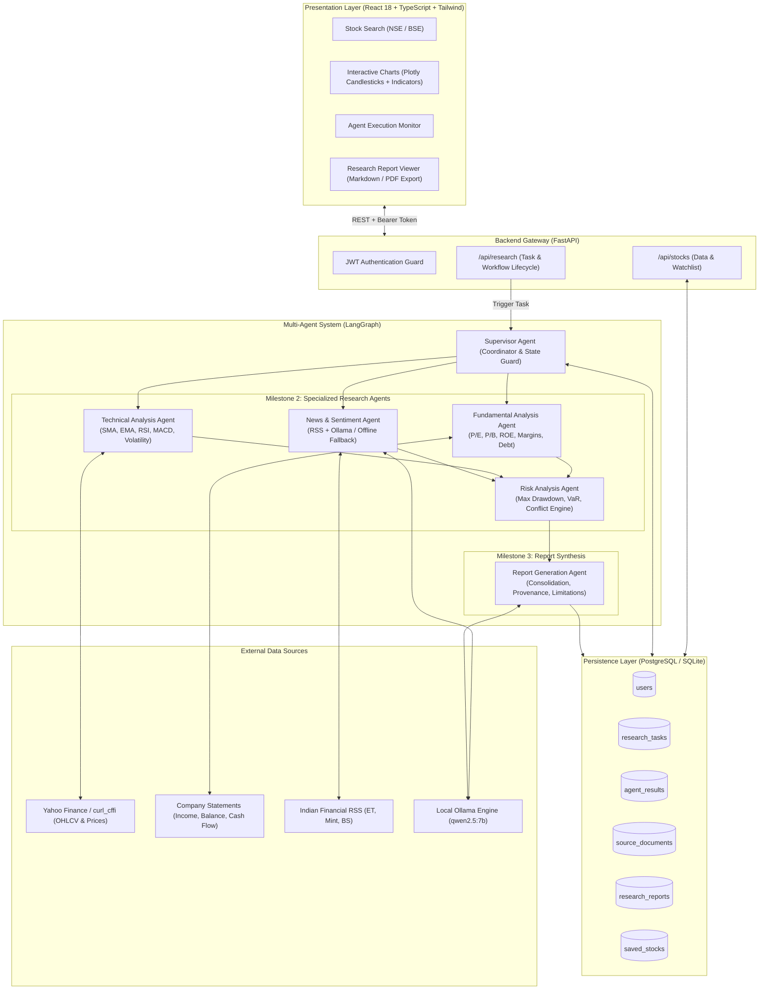
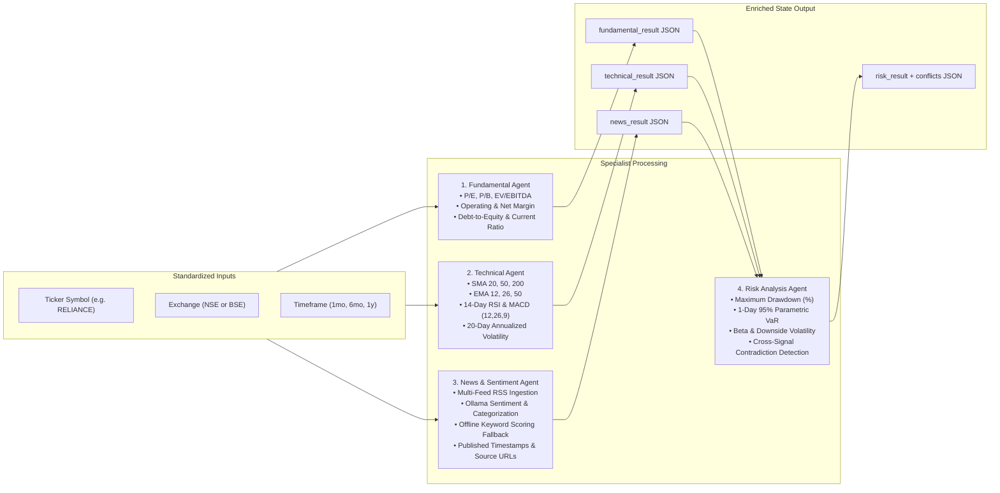
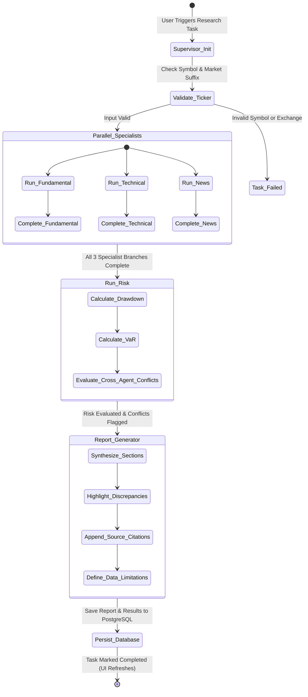
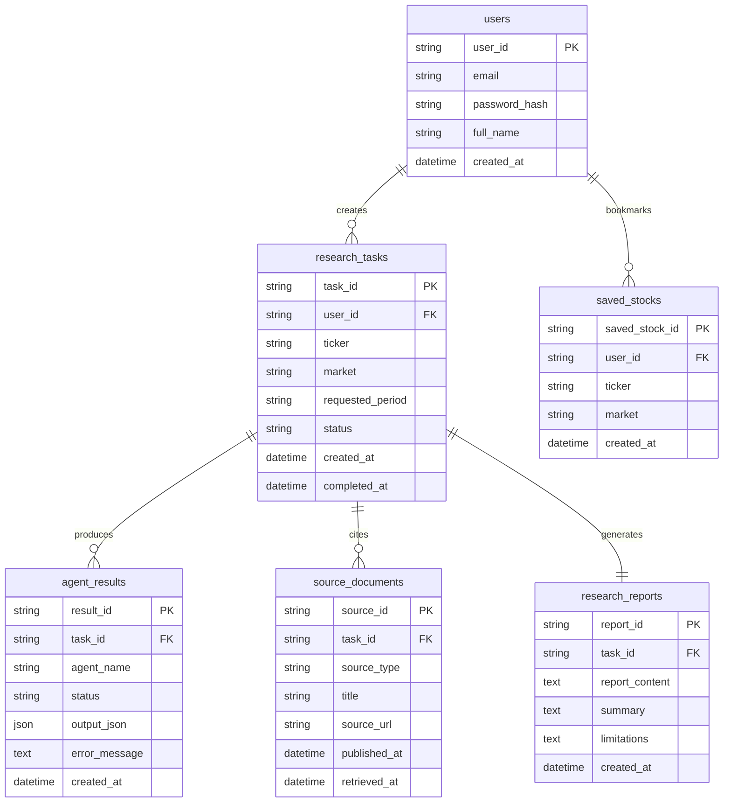

# Multi-Agent Stock Research Analyst: Architecture & Engineering Design

Based on the architecture diagram and project roadmap, this design document details the system design, data flows, mathematical models, and implementation specifications for **Milestone 2 (Financial Tools & Individual Agents)** and **Milestone 3 (Supervisor Orchestration & Report Generation)**.

---

## 1. End-to-End System Blueprint

---

## 2. Milestone 2: Financial Analysis Tools & Individual Agents

Milestone 2 focuses on creating the four domain-specific research agents. Each agent operates with strict typed inputs and outputs, deterministic fallbacks, and zero data fabrication.

### 2.1. Mathematical & Algorithmic Specifications

#### A. Fundamental Analysis Formulations
* **Valuation Multiples**:
  $$\text{P/E Ratio} = \frac{\text{Current Market Price}}{\text{Earnings Per Share (EPS)}}, \quad \text{P/B Ratio} = \frac{\text{Current Market Price}}{\text{Book Value Per Share}}$$
* **Profitability Margins**:
  $$\text{Operating Margin} = \left(\frac{\text{Operating Income}}{\text{Total Revenue}}\right) \times 100$$
  $$\text{Net Profit Margin} = \left(\frac{\text{Net Income}}{\text{Total Revenue}}\right) \times 100, \quad \text{ROE} = \left(\frac{\text{Net Income}}{\text{Shareholders' Equity}}\right) \times 100$$
* **Solvency & Gearing**:
  $$\text{Debt-to-Equity} = \frac{\text{Total Debt}}{\text{Total Equity}}, \quad \text{Current Ratio} = \frac{\text{Current Assets}}{\text{Current Liabilities}}$$

#### B. Technical Analysis Formulations
* **Simple Moving Average (SMA)**:
  $$\text{SMA}_n(t) = \frac{1}{n}\sum_{i=0}^{n-1} P_{t-i}$$
* **Exponential Moving Average (EMA)**:
  $$\text{EMA}_t = P_t \cdot \alpha + \text{EMA}_{t-1} \cdot (1 - \alpha), \quad \alpha = \frac{2}{n + 1}$$
* **Relative Strength Index (RSI - 14 Days)**:
  $$\text{RSI} = 100 - \frac{100}{1 + \text{RS}}, \quad \text{RS} = \frac{\text{Smoothed Gain}_{14}}{\text{Smoothed Loss}_{14}}$$
  * *Zero Loss Condition*: If average loss $= 0$ in an uninterrupted uptrend, $\text{RSI} = 100.0$.
* **Moving Average Convergence Divergence (MACD 12, 26, 9)**:
  $$\text{MACD Line} = \text{EMA}_{12}(P) - \text{EMA}_{26}(P)$$
  $$\text{Signal Line} = \text{EMA}_9(\text{MACD Line})$$
  $$\text{Histogram} = \text{MACD Line} - \text{Signal Line}$$
* **Annualized Historical Volatility**:
  $$\sigma_{\text{ann}} = \sqrt{252} \cdot \sqrt{\frac{1}{N-1}\sum_{i=1}^N (r_i - \bar{r})^2} \times 100, \quad r_i = \ln\left(\frac{P_i}{P_{i-1}}\right)$$

#### C. News & Sentiment Scoring Engine
* **Ollama Structured Extraction**: Prompt formatted to return strict JSON schema:
  `{"sentiment": "positive|negative|neutral", "category": "earnings|regulatory|deal|general", "reason": "..."}`.
* **Deterministic Fallback Lexicon**: Token-matching financial keyword scoring prevents failure if Ollama is unreachable.
* **Data Provenance**: Every headline records its publisher domain, published UTC timestamp, and canonical article URL.

#### D. Risk Analysis & Cross-Signal Contradiction Engine
* **Maximum Drawdown (MDD)**:
  $$\text{MDD} = \min_{t \in [0, T]} \left(\frac{P_t - \max_{\tau \le t} P_\tau}{\max_{\tau \le t} P_\tau}\right) \times 100$$
* **Value at Risk (Parametric 95% 1-Day VaR)**:
  $$\text{VaR}_{95\%} = 1.645 \cdot \sigma_{\text{daily}} \times 100$$
* **Cross-Agent Contradiction Detection Rules**:
  1. *Rule 1*: Technical signal is `Bullish`, but Fundamental Net Profit Margin is negative ($< 0$).
  2. *Rule 2*: Technical RSI indicates Overbought ($> 70$), while Fundamental P/E is elevated ($> 50$).
  3. *Rule 3*: Technical momentum is `Bullish`, but recent News Sentiment is predominantly `Negative`.

---

## 3. Milestone 3: Supervisor Agent & Report Generation

Milestone 3 orchestrates the research workflow using **LangGraph**, providing bounded retries, error recovery, and consolidated report synthesis.

### 3.1. Supervisor Orchestration Components

1. **State Machine (`ResearchState`)**:
   * Shared graph context tracking execution status (`pending`, `running`, `completed`, `failed`, `unavailable`) for every node.
   * State updates are immutable and append-only across nodes.

2. **Conditional Routing & Resilient Retries**:
   * If an agent fails (e.g., Yahoo Finance rate limits or network timeout), the Supervisor retries up to 2 times with exponential backoff.
   * If retries are exhausted, the agent state is flagged as `unavailable` with a documented reason, allowing downstream nodes to continue without crashing the workflow.

3. **Report Generation Agent**:
   * Uses local Ollama (`qwen2.5:7b`) with temperature $0.2$ to synthesize outputs into an institutional research report.
   * **Mandatory Sections in Final Report**:
     * **Executive Summary**: Investment thesis and composite sentiment.
     * **Fundamental Health Overview**: Capital structure, valuation multiples, and profitability analysis.
     * **Technical Setup**: Key moving averages, momentum oscillator status, and support/resistance zones.
     * **News & Catalyst Timeline**: Chronological headline digest with sentiment classifications.
     * **Risk Factors & Contradictions**: Highlighted discrepancies detected by the Risk Agent.
     * **Data Provenance & Audit Trail**: Footnotes referencing all URLs and retrieval timestamps.
     * **Limitations & Disclaimers**: Explicit note that calculations are historical and not financial advice.

4. **Persistence Layer Updates**:
   * Synchronizes task progress to PostgreSQL / SQLite:
     * `research_tasks` updated with status and completion timestamps.
     * `agent_results` stores individual agent JSON outputs.
     * `source_documents` tracks ingested links and content hashes.
     * `research_reports` stores the final Markdown document for rendering and PDF generation.

---

## 4. Database Entity Relationships (Milestones 2 & 3)

---

## 5. Implementation Roadmap & Verification Plan

| Phase | Milestone | Deliverable | Verification Standard |
|---|---|---|---|
| **Step 1** | M2 | Ratio & Indicator Calculators | Tested with `pytest` against known manual benchmarks (`test_technical_indicators.py`). |
| **Step 2** | M2 | Fundamental & Technical Agents | Verifies data parsing, division-by-zero safety, and `unavailable` flagging. |
| **Step 3** | M2 | News & Sentiment Agent | RSS fetching validated across ET and LiveMint feeds with offline fallback. |
| **Step 4** | M2 | Risk Analysis Agent | Maximum Drawdown and conflict rules tested against synthetic contradictory data. |
| **Step 5** | M3 | LangGraph Supervisor | Validates state transitions, parallel branch merging, and retry policies. |
| **Step 6** | M3 | Report Generation Agent | Markdown generation with audit footnotes and PDF export capability. |
| **Step 7** | M3 | End-to-End Orchestration | Full pipeline execution tested across 3 diverse equities on NSE and BSE. |
